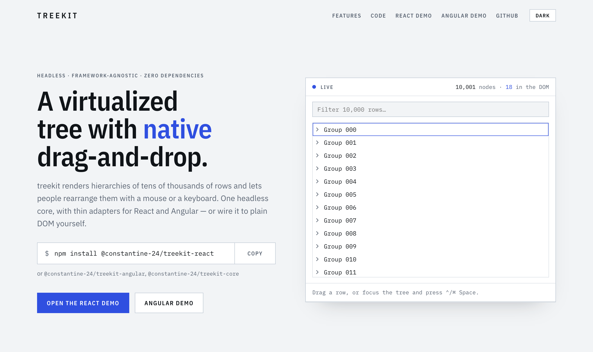
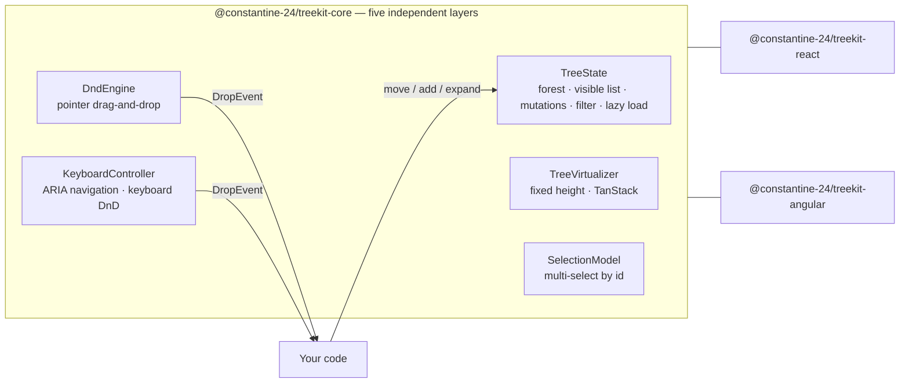

<div align="center">

# treekit

**A virtualized tree with native drag-and-drop — headless core, Angular and React adapters.**

[](https://www.npmjs.com/package/@constantine-24/treekit-core)
[](https://www.npmjs.com/package/@constantine-24/treekit-react)
[](https://www.npmjs.com/package/@constantine-24/treekit-angular)
[](https://github.com/Constantine-24/treekit/actions/workflows/ci.yml)
[](https://bundlephobia.com/package/@constantine-24/treekit-core)
[](packages/core/package.json)
[](LICENSE)

**[Live demo](https://constantine-24.github.io/treekit/)** · [React showcase](https://constantine-24.github.io/treekit/react/) · [Angular showcase](https://constantine-24.github.io/treekit/angular/) · [Docs](#documentation) · [Contributing](CONTRIBUTING.md)

<picture>
  <source media="(prefers-color-scheme: dark)" srcset="docs/images/demo-dark.png">
  
</picture>

</div>

## Why treekit?

Most tree widgets bolt drag-and-drop onto a flow-layout list, and that falls apart once the list is virtualized: placeholder rows shift absolutely positioned siblings, indices lie, and drop feedback flickers. treekit starts from the other end — **rows are positioned by a virtualizer, and every drop is resolved from the pointer position against the rendered rows.** Nothing is ever inserted into the layout; a single insertion line or folder highlight is drawn on top.

- **Virtualized** — only the visible rows exist in the DOM; 10,000+ nodes stay smooth. Fixed heights built in, measured rows through TanStack Virtual.
- **Native HTML5 drag-and-drop** — reorder, drop into folders, and accept drags from outside the tree (plain `draggable` + `dataTransfer`), with `into` / `before` / `after` intent, edge auto-scroll and spring-loaded folders.
- **Keyboard drag-and-drop** — every pointer operation has a keyboard equivalent (grab → move → drop) that emits the same events, with screen-reader announcements. It is the supported path on touch.
- **Multi-select** — click, ⌃/⌘-click, Shift-click, Shift+arrows and select-all, with drags that carry the whole selection, normalized to document order and de-nested.
- **Filtering & lazy loading** — filters keep the ancestors of every match without touching expansion state; folders can load their children on demand.
- **Headless and zero-dependency** — five independent layers that work against plain DOM. The core never mutates your data on drop: it reports a `DropEvent`, and your code decides.
- **Accessible** — WAI-ARIA tree semantics with `aria-activedescendant`; the demos score 100 in Lighthouse accessibility.

## Packages

| Package                                                                       | What it is                                                                           |
| ----------------------------------------------------------------------------- | ------------------------------------------------------------------------------------ |
| [`@constantine-24/treekit-core`](packages/core#readme)                        | The headless engine: tree state, virtualization, drag-and-drop, keyboard, selection. |
| [`@constantine-24/treekit-react`](packages/react#readme)                      | `<TkTree>` for React 18 and 19.                                                      |
| [`@constantine-24/treekit-angular`](packages/angular/projects/treekit#readme) | `<tk-tree>` for Angular 22+. No Material or CDK dependency.                          |

The two adapters have the same features, the same markup and the same `--tk-*` theming tokens.

## Installation

```bash
npm install @constantine-24/treekit-core @constantine-24/treekit-react     # React
npm install @constantine-24/treekit-core @constantine-24/treekit-angular   # Angular
npm install @constantine-24/treekit-core                    # anything else
```

Keep every `@constantine-24/treekit-*` package on the same version — they are released in lockstep.

| Peer dependency           | Needed by                                                                   |
| ------------------------- | --------------------------------------------------------------------------- |
| `react`, `react-dom`      | `@constantine-24/treekit-react` (`^18 \|\| ^19`)                            |
| `@angular/core`, `common` | `@constantine-24/treekit-angular` (`>=22`)                                  |
| `@tanstack/virtual-core`  | optional — only for measured rows (`@constantine-24/treekit-core/tanstack`) |

## Quick start

Each adapter renders a `TreeState` you own, and reports drops for you to apply.

### React

```tsx
import { TreeState } from '@constantine-24/treekit-core';
import { TkTree } from '@constantine-24/treekit-react';
import '@constantine-24/treekit-react/styles.css';
import { useState } from 'react';

interface FileItem {
  size: number;
}

export function FileTree() {
  const [state] = useState(() => {
    const tree = new TreeState<FileItem>();
    tree.setSource([
      {
        id: 'src',
        name: 'src',
        item: { size: 0 },
        isFolder: true,
        children: [{ id: 'main', name: 'main.ts', item: { size: 812 } }],
      },
      { id: 'readme', name: 'README.md', item: { size: 2048 } },
    ]);
    return tree;
  });

  return (
    <div style={{ height: 400 }}>
      <TkTree
        state={state}
        ariaLabel="Files"
        // The tree only reports the drop; your code applies it.
        onDrop={drop => {
          if (drop.target) state.moveMany([...drop.nodes], drop.target);
        }}
      />
    </div>
  );
}
```

### Angular

```ts
import { Component } from '@angular/core';
import { TkTree } from '@constantine-24/treekit-angular';
import { DropEvent, TreeState } from '@constantine-24/treekit-core';

interface FileItem {
  size: number;
}

@Component({
  selector: 'app-file-tree',
  imports: [TkTree],
  template: `
    <tk-tree [state]="state" ariaLabel="Files" (dropped)="onDrop($event)" style="height: 400px" />
  `,
})
export class FileTree {
  readonly state = new TreeState<FileItem>();

  constructor() {
    this.state.setSource([
      {
        id: 'src',
        name: 'src',
        item: { size: 0 },
        isFolder: true,
        children: [{ id: 'main', name: 'main.ts', item: { size: 812 } }],
      },
      { id: 'readme', name: 'README.md', item: { size: 2048 } },
    ]);
  }

  // The tree only reports the drop; your code applies it.
  onDrop(drop: DropEvent<FileItem>): void {
    if (drop.target) this.state.moveMany([...drop.nodes], drop.target);
  }
}
```

### Any framework, or none

The core attaches to plain DOM. Rows can render however you like — the engines only need absolutely positioned row elements carrying `data-node-id`:

```ts
import {
  DndEngine,
  DropEvent,
  FixedHeightVirtualizer,
  KeyboardController,
  TreeState,
} from '@constantine-24/treekit-core';

const state = new TreeState<null>();
state.setSource(roots);

const onDrop = (drop: DropEvent<null>) => {
  if (drop.target) state.moveMany([...drop.nodes], drop.target);
};
const canDropAt = state.canMoveMany.bind(state);

const virtualizer = new FixedHeightVirtualizer({ rowHeight: 28 });
const dnd = new DndEngine({
  getVisibleNodes: () => state.visibleNodes(),
  onDrop,
  canDropAt,
  onStateChange: render,
});
const keyboard = new KeyboardController({ state, onDrop, canDropAt, onStateChange: render });

state.subscribe(() => {
  virtualizer.setCount(state.visibleNodes().length);
  render();
});
virtualizer.attach(viewport, render); // render() draws virtualizer.items() into `content`
dnd.attach(viewport, content);
viewport.addEventListener(
  'keydown',
  event => keyboard.handleKeyDown(event) && event.preventDefault()
);
```

The complete version of this snippet is on the [landing page](https://constantine-24.github.io/treekit/#code), and [`apps/demo-vanilla`](apps/demo-vanilla) is a full plain-DOM app.

## How it works



The layers share no state — only `TreeNode` identity and the `data-node-id` attribute — so each can be used alone. Both engines emit the same `DropEvent`, and neither ever mutates the tree: `canDropAt` decides what may light up, and your `onDrop` decides what happens. Architecture notes for contributors live in [`.claude/rules/architecture.md`](.claude/rules/architecture.md) and [`packages/core/CLAUDE.md`](packages/core/CLAUDE.md).

## Documentation

- **[@constantine-24/treekit-core](packages/core#readme)** — the layers, the drop model, virtualizers, and the full API list.
- **[@constantine-24/treekit-react](packages/react#readme)** — props, callbacks, render props, the imperative handle, theming.
- **[@constantine-24/treekit-angular](packages/angular/projects/treekit#readme)** — inputs, outputs, templates, the imperative API, theming.
- **Showcases** — the [React](https://constantine-24.github.io/treekit/react/) and [Angular](https://constantine-24.github.io/treekit/angular/) instrument panels run 10,000 rows with multi-select, palette drags, filtering, a lazy branch and spring loading, and draw the library's own drop arithmetic live (`resolveDropIntent`) as you hover mid-drag. Their sources are [`apps/demo-react`](apps/demo-react) and [`apps/demo-angular`](apps/demo-angular).

## Compatibility

| Package                           | Requires                                                 |
| --------------------------------- | -------------------------------------------------------- |
| `@constantine-24/treekit-core`    | Any evergreen browser (ES2022). No runtime dependencies. |
| `@constantine-24/treekit-react`   | React 18 or 19. Client component (`'use client'`).       |
| `@constantine-24/treekit-angular` | Angular 22+, standalone, zoneless-ready.                 |

## Limitations

Read these before adopting:

- **Native HTML5 drag-and-drop does not fire from touch gestures on Android Chrome.** Desktop, mouse and pen work everywhere, and iOS Safari supports native DnD. Keyboard drag-and-drop is the supported fallback on touch.
- The built-in virtualizer assumes a **fixed row height**. Variable heights need `TanStackVirtualizer` from `@constantine-24/treekit-core/tanstack` (install `@tanstack/virtual-core`); both adapters then measure rows automatically.
- The tree **owns its scroll viewport** — there is no window-scroll mode.
- **Enabling multi-select changes one key**: `Space` toggles selection and `Ctrl/Cmd+Space` grabs a row for keyboard drag. Without multi-select, `Space` grabs. Every unambiguous alternative chord collides with a browser or OS shortcut.
- Selection is **explicit**: selecting a folder does not select its descendants, because a move already relocates the whole subtree.
- **RTL** layouts are untested.

## Contributing

Bug reports and pull requests are welcome — see [CONTRIBUTING.md](CONTRIBUTING.md). In short:

```bash
corepack enable && pnpm install
pnpm build && pnpm test
pnpm --filter site dev    # the landing page, live against the library sources
```

Releases are automated with [Changesets](https://github.com/changesets/changesets) and published to npm with provenance.

## License

[MIT](LICENSE) © Konstantin Penzin
